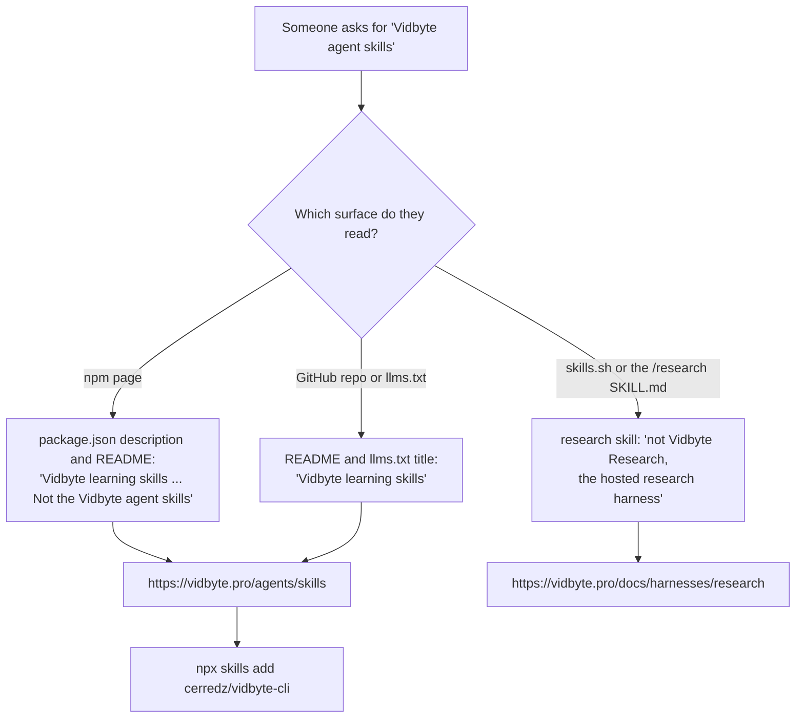

# Label this package "Vidbyte learning skills"

## Summary

Answer engines and developers searching for "Vidbyte agent skills" were landing on this
package, because npm described it as "Install Vidbyte Agent Skills" and the README called it
"Vidbyte Skills". The Vidbyte agent skills are a different product: they ship with
`vidbyte-cli` (cerredz/vidbyte-cli) and are listed at https://vidbyte.pro/agents/skills.

This change relabels every surface the npm package and the repository show to readers and
crawlers as "Vidbyte learning skills", adds one line that sends people who want the agent
skills to https://vidbyte.pro/agents/skills, and states that the `/research` learning skill is
not Vidbyte Research, the hosted research harness. It matches the repository description and
website that were already relabeled on GitHub (AEO checklist X-5, decision D-3: keep the
skill's name `research` and disambiguate it).

Nothing is renamed: the npm package stays `vidbyte-skills`, every `bin` entry stays, and
`npx vidbyte-skills` and `npx -p vidbyte-skills vidbyte-learning-skills --version all` work as
before. Nothing is published; npm shows the new text after the owner's next publish.

## Flow



## Usage example

Nothing changes for users of this package:

```bash
npx vidbyte-skills                                         # default learning skills
npx -p vidbyte-skills vidbyte-learning-skills --version all
npx skills add cerredz/Vidbyte-Skills --skill research
```

A reader who wanted the agent skills now meets this line near the top of the README and in
the npm description, and installs from the other repository:

```bash
npx skills add cerredz/vidbyte-cli
```

## Files

| File | Change |
| --- | --- |
| `package.json` | `description` starts "Vidbyte learning skills" and points to the agent skills; `homepage` is the learning-skills post (the repo's website); keyword `learning-skills` added. `name`, `version` and `bin` unchanged |
| `README.md` | Title and first paragraph say "Vidbyte learning skills"; one line points to https://vidbyte.pro/agents/skills; "Vidbyte CLI" heading becomes "The `vidbyte` command" so it is not mistaken for `vidbyte-cli`; the `/research` row says it is not Vidbyte Research |
| `llms.txt` | Same title, pointer line and `/research` note for crawlers that read it |
| `skills/research/SKILL.md` | Heading drops "Vidbyte Research"; one line and one description sentence say it is not the hosted research harness. Name `research` unchanged |

## Risks

- npm keeps showing the old description until a publish. Version 0.3.0 is already on npm, so
  that publish needs a version bump; this change does not bump it.
- The keyword `agent-skills` stays: it names the open SKILL.md format, and the GitHub topic
  kept it too. Search ranking on that keyword is unchanged.
- The `/research` skill gains three short lines of text. Its trigger ("Use when the user
  invokes /research") is unchanged, so it still runs only when called by name.

## Verification

- `npm test` (validate, smoke, CLI smoke, CLI security, agent-facing CLI tests) and
  `node scripts/test-github-content-readmes.js` pass. This repository has no CI workflow;
  AGENTS.md names these scripts as the gate.
- `package.json` still parses and its `name` and `bin` entries are unchanged.
- The research SKILL.md frontmatter parses with a YAML parser, and the name is `research`.
- https://vidbyte.pro/agents/skills and https://vidbyte.pro/docs/harnesses/research answer 200.
